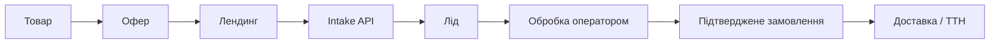

# CRMONIA — Product Vision

**Стан документа:** огляд коду в `develop` на 2026-10-24. Це опис фактичного
стану репозиторію та погодженого напряму продукту, а не твердження про стан
будь-якого розгорнутого середовища.

## Призначення

CRMONIA — центральна CRM медіабаєра для керування власними e-commerce
пропозиціями та потоком заявок: від реклами й лендингу до роботи оператора,
замовлення та доставки. Продукт має бути простим для щоденної роботи й надійно
ізолювати дані між учасниками бізнес-процесу.

### Погоджена модель першого етапу

Цільова модель — одна центральна CRMONIA під керуванням власника, у якій
працюють кілька постачальників зі своїми операторами та ізольованими даними.
Це погоджений продуктовий напрям, а не твердження про вже реалізовану
ізоляцію постачальників. Технічне відображення цієї моделі через `workspace`,
`team` або окрему сутність `supplier` залишається відкритим і потребує окремого
аналізу до змін схеми та правил доступу.

Основний принцип: одна узгоджена бізнес-модель і зрозумілий наскрізний процес.
Інтерфейс та набір функцій поки змінюються; архітектура має дозволяти змінювати
екрани незалежно від правил доступу, бізнес-логіки й збереження даних.

## Позначення стану

- **Реалізовано в репозиторії** — відповідні код, схема, API або тести є в дереві
  проєкту. Це не підтверджує, що міграція застосована до конкретної БД або що
  функція перевірена в production.
- **У роботі** — зміни є лише в поточному незакоміченому дереві або потребують
  міграції чи зовнішньої перевірки перед активацією.
- **Заплановано** — напрям, визначений для подальшої реалізації.
- **Гіпотеза** — припущення про модель чи UX, яке слід перевірити на реальному
  процесі до розробки.

Стан SQL-міграцій перевіряйте окремо для кожного середовища. У цьому snapshot
локально присутня незакомічена підготовка Pixel ID для лендингу з міграцією
`20261024140000_landing_tiktok_pixel_configuration.sql`; її не слід вважати
застосованою чи активованою.

## Можливості в репозиторії

| Модуль                   | Фактичний стан                                                                                                                                                                                                                                                                                                                                                                                    |
| ------------------------ | ------------------------------------------------------------------------------------------------------------------------------------------------------------------------------------------------------------------------------------------------------------------------------------------------------------------------------------------------------------------------------------------------- |
| Доступ і адміністрування | Supabase Auth, запрошення, ролі Super Admin/Admin/Operator/Viewer, індивідуальні дозволи, області workspace/team/operator/offer, RLS та журнал аудиту доступу. У робочому процесі передбачено один основний workspace; фактичні членства та дозволи залежать від БД.                                                                                                                              |
| Ліди                     | Ручна робота з лідами та публічний `POST /api/v1/intake/leads`. Intake визначає workspace й offer зі збереженої інтеграції, перевіряє origin, валідує та нормалізує телефон, має rate limiting, honeypot та idempotency. Зберігає UTM, `ttclid`, `sub_id` і доступні дані доставки.                                                                                                               |
| Товари                   | Workspace-каталог із назвою, SKU, цінами в копійках UAH, фото-посиланням, вагою, габаритами та текстовою назвою постачальника. Собівартість віддається лише за окремим дозволом. Це ще не реєстр постачальників.                                                                                                                                                                                  |
| Офери                    | Використовується наявна `workspace_offers`, пов’язана з `products` у межах workspace. Офер має власну назву, ціну й активність; його ціна не змінює каталог товарів.                                                                                                                                                                                                                              |
| Замовлення               | Окрема модель замовлення, пов’язана з лідом та офером, зі snapshot товару, ціни й контактів. Статуси замовлення відокремлені від статусів ліда та доставки. Поточна модель MVP — один товар/офер на замовлення, не кошик із позиціями.                                                                                                                                                            |
| Доставка                 | Окрема модель shipment/операції ТТН. Є серверний адаптер API Нової пошти v2.0, довідники з реальними Ref, шифрування ключа, перевірки дозволів та захист від повторного створення. Тестові сценарії використовують mock API. Післяплата NovaPay і «Контроль оплат» заблоковані: точний сумісний контракт v2.0 не підтверджений. Налаштування відправника зараз workspace-рівня, не постачальника. |
| Landing Factory          | Приватне збереження ZIP, перевірка структури й шляхів, пошук кореня сайту, статичний аналіз та обмежений адаптер стандартної HTML-форми до Intake API. Код не виконує завантажений JavaScript на сервері. Публікація, керування доменами та пов’язаний deploy-процес у CRM відсутні.                                                                                                              |
| Pixel і атрибуція        | Intake зберігає рекламні параметри. Поточне незакомічене дерево додає до адаптера TikTok Pixel ID, `PageView` і `SubmitForm` після підтвердженого прийняття заявки; активація залежить від нової міграції та перевірки на тестовому середовищі. Це не Pixel Manager і не система рекламних кампаній.                                                                                              |
| Мова та тема             | Інтерфейс має централізовані українську й англійську локалізації та Light/Dark. Нові підписи не повинні змінювати внутрішні статуси, permission IDs чи API-значення.                                                                                                                                                                                                                              |

Ключові моделі в SQL: `leads`, `products`, `workspace_offers`,
`workspace_orders`, `workspace_order_shipments`,
`workspace_nova_poshta_settings`, `workspace_landings` та таблиці доступу.
Нові моделі мають повторно використовувати ці сутності й чинні permission scopes,
якщо доменна вимога не доводить потребу в розширенні.

## Основний бізнес-процес

Цей ланцюжок описує цільовий процес. Частини до створення замовлення вже
представлені в коді; автоматизована публікація лендингу та післяплата через НП
поки не готові. Життєві цикли ліда, замовлення та доставки мають залишатися
окремими. Заявка починається з мінімальних контактних даних; оператор доповнює
інформацію під час дзвінка. Створення чернетки замовлення саме по собі не змінює
статус ліда й не створює ТТН.

## Напрям розвитку

### Заплановано

- **Постачальники та їхні оператори:** спільне кероване середовище з окремими
  доступами, даними й налаштуваннями відправника/Нової пошти для кожного
  постачальника. Перед реалізацією треба визначити межу між workspace,
  постачальником і командою; зараз сутності `Supplier` немає.
- **Замовлення з кількох товарних позицій:** окремі order items із незмінними
  snapshot назви, кількості та ціни. Поточну однопозиційну модель не називати
  багатотоварною.
- **Домени й публікація:** реєстр доменів, зв’язок домену з лендингом, офером та
  пікселем, перевірка DNS/HTTPS і контрольований процес публікації. Landing
  Factory зараз готує ZIP, але не розгортає сайт.
- **Атрибуція та автоматизація:** деталізація рекламних джерел і зменшення
  ручної роботи на основі даних, що вже надходять через Intake.
- **Інтеграції кол-центрів:** документовані версійовані API/webhook-контракти,
  синхронізація статусів, ідемпотентність і безпечні повтори.
- **Інфраструктура:** перехід із тимчасового Render development-хостингу на VPS
  або іншу інфраструктуру після визначення вимог до резервного копіювання,
  оновлень, спостережуваності та відновлення.

### Гіпотези для перевірки

- Чи повинні постачальники бути окремими учасниками одного workspace, окремими
  workspace чи пов’язаними бізнес-організаціями з обмеженим доступом.
- Чи потрібні оферам варіанти товару та кілька постачальників, чи перший
  робочий потік можна підтримувати простими товарними позиціями.
- Які саме події, retry-вікна та правила конфліктів статусу потрібні незалежним
  кол-центрам.
- Яка частина публікації лендингів має бути автоматизована, а де потрібне
  підтвердження людини.

Не створювати ці моделі або абстракції наперед без конкретного сценарію.

## Принципи UX

- Оператор працює з лідами й замовленнями у короткому зрозумілому процесі та
  бачить доступні дані в контексті поточного запису.
- Не вимагати дані, які не потрібні на поточному етапі; не вигадувати відсутні
  значення та довідникові Ref.
- Фіксувати ціну й характеристики в замовленні там, де подальша зміна каталогу
  не повинна змінювати історичний запис.
- Показувати один зрозумілий стан для кожного життєвого циклу; не змішувати
  статуси ліда, замовлення та доставки.
- Підтримувати природні українські й англійські тексти. Внутрішні коди й
  дозволи лишаються незалежними від локалізації.
- Зберігати компактний стиль CRMONIA, але не фіксувати передчасно компонування
  екранів, що ще розвиваються.

## Принципи технічної еволюції

Поточний напрям — модульний моноліт на TanStack Start і PostgreSQL/Supabase,
без попереднього поділу на мікросервіси. Розділяти UI, API, правила домену,
авторизацію та доступ до БД малими межами. Зовнішній провайдер має залишатися
деталлю інтеграції, а не внутрішнім ідентифікатором моделі. Правила роботи в
коді, міграціях, тестах і дозволених діях описані в `AGENTS.md`.
